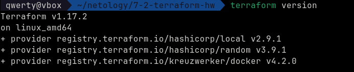
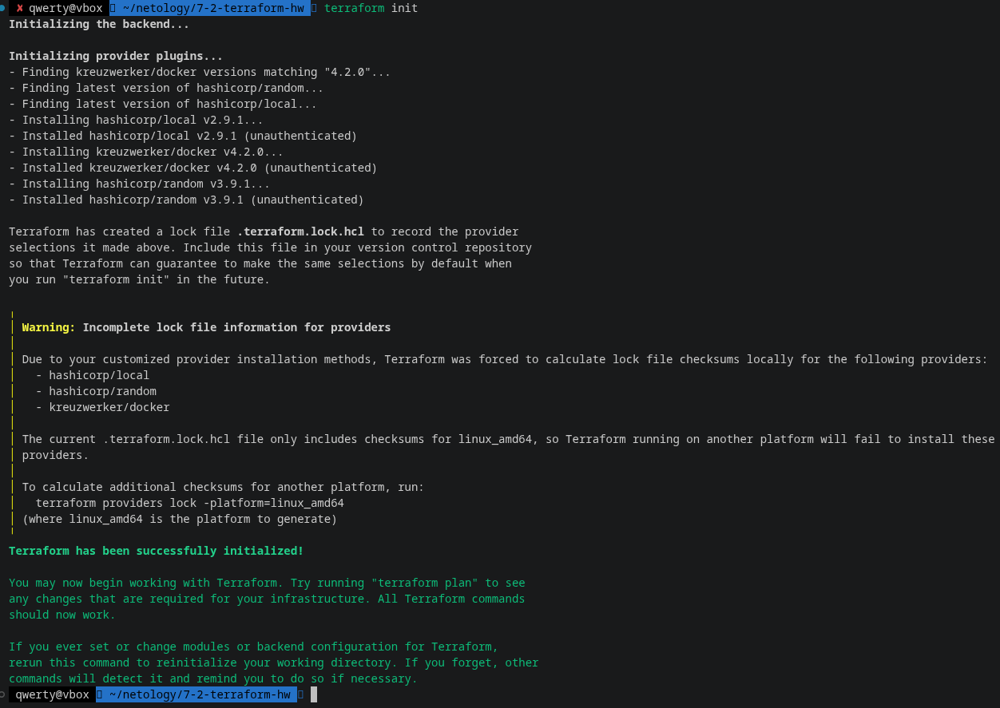
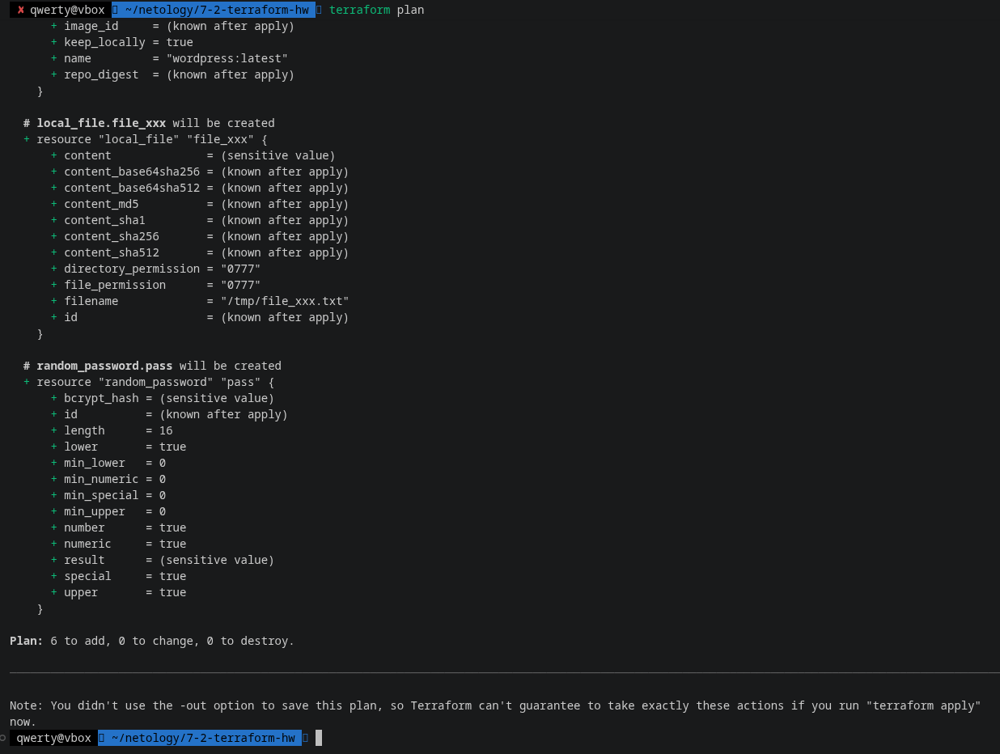
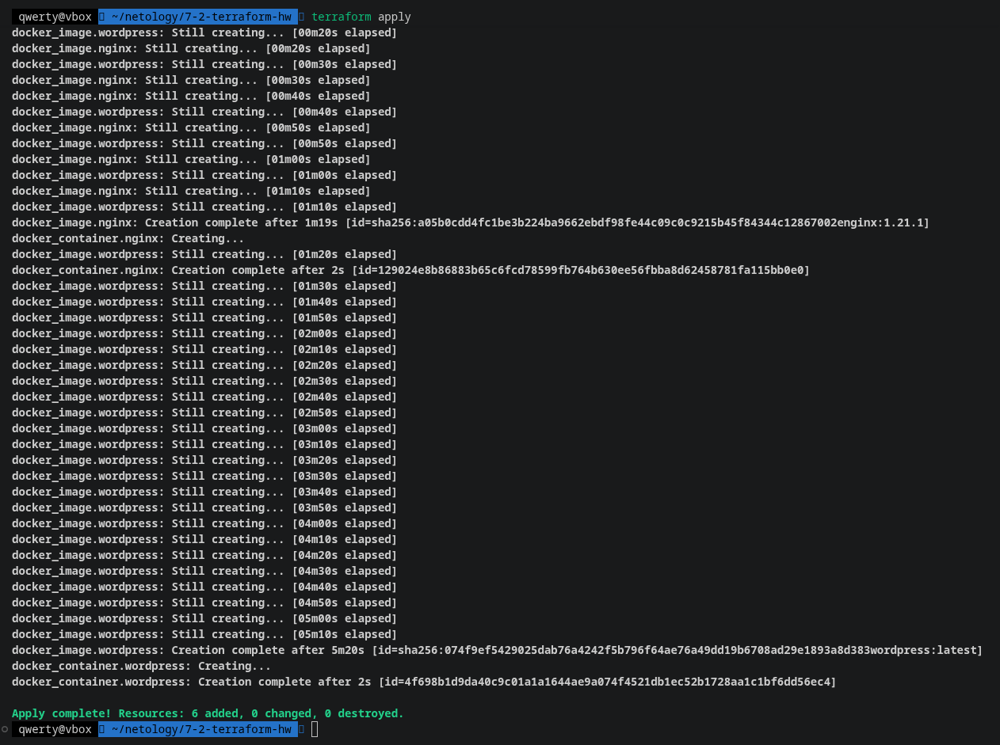

# Домашнее задание к занятию "Terraform" - Качьянов Вадим


### Задание 1

Был установлен terraform, результат выполнения на рисунке:



### Задание 2

В данном задании был написан код, который поднимает 2 docker контейнера nginx и wordpress:

## main.tf:

```hcl
resource "docker_image" "nginx" {
  name = var.containers.nginx.image
  keep_locally = true
}

resource "docker_image" "wordpress" {
  name = var.containers.wordpress.image
  keep_locally = true
}

resource "docker_container" "nginx" {
  image = docker_image.nginx.image_id
  name = "best-container-in-the-world-${var.containers.nginx.name}"
  ports {
    internal = var.containers.nginx.ports.internal
    external = var.containers.nginx.ports.external
  }
  network_mode="bridge"
}

resource "docker_container" "wordpress" {
  image = docker_image.wordpress.image_id
  name = "best-container-in-the-world-${var.containers.wordpress.name}"
  ports {
    internal = var.containers.wordpress.ports.internal
    external = var.containers.wordpress.ports.external
  }
}

resource "random_password" "pass" {
  length = 16
}

resource "local_file" "file_xxx" {
  content = "our-cool-project-${random_password.pass.result}"
  filename = "/tmp/file_xxx.txt"
}

data "local_file" "from_file"{
  filename = "/etc/passwd"
}
```

## variables.tf:
```hcl
variable "string"{
  type=string
  default = "def string"
}

variable "number" {
  type=number
  default = 0
}

variable "list_of_strings" {
  type = list(string)
  default = [ "a", "b", "c" ]
}

variable "list_of_numbers" {
  type = list(number)
  default = [ 0, 1, 2 ]
}

variable "bool" {
  type = bool
  default = false
}

variable "map" {
  type = map(string)
  default = {
    "str1" = "value1"
    "str2" = "value2"
    "str3" = "value3"
  }
}

variable "containers" {
  type = map(object({
    name = string
    image = string
    ports = object({
      external = number
      internal = number
    })
  }))
  default = {
    nginx = {
      name = "nginx"
      image = "nginx:1.21.1"
      ports = {
        external = 1080
        internal = 80
      }
    },
    wordpress = {
        name = "wordpress"
        image = "wordpress:latest"
        ports = {
          external = 2080
          internal = 80
        }
    }
  }
}
```


## providers.tf:
```hcl
terraform {
  required_version = ">=1.17.0"

  required_providers {
    docker = {
      source  = "kreuzwerker/docker"
      version = "4.2.0"
    }
  }
}

provider "docker" {
  host="unix:///var/run/docker.sock"
}
```

Результаты выполнения команд:
1) terraform init

2) terraform plan

3) terraform apply
